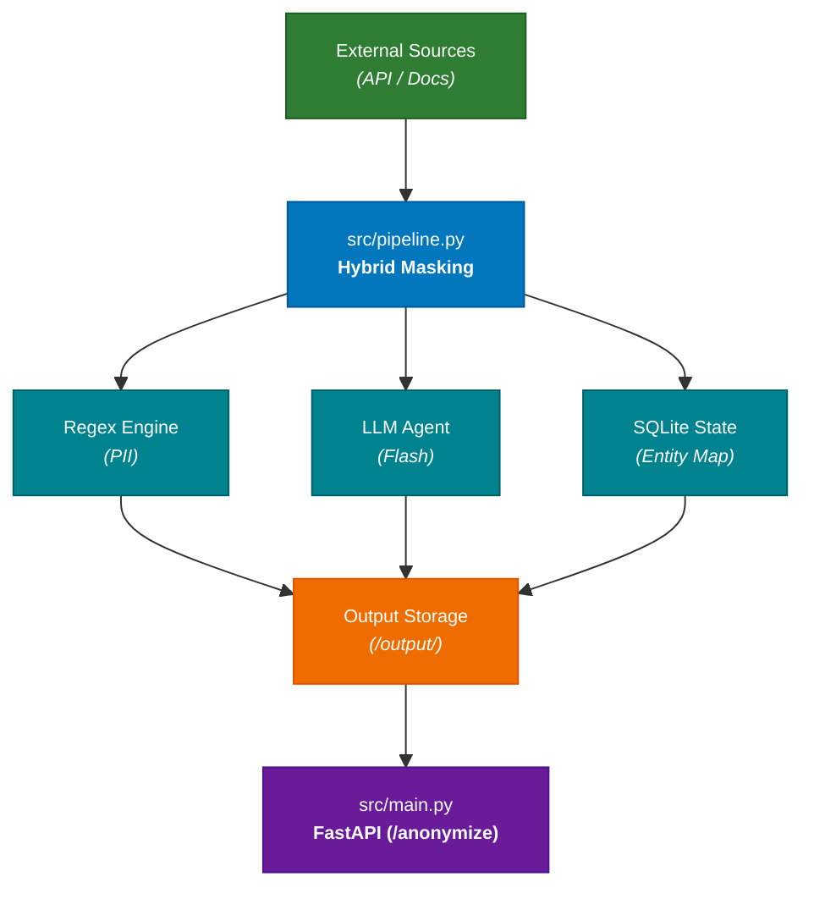

# System Design: Privacy-Preserving Data Anonymization Engine

## 1. Executive Summary

The objective of this architecture is to build a robust, high-performance data anonymization and privacy-preserving pipeline for **Kipu Pay**'s support corpus (2,028 chat messages, 26 documents, 6,243 table rows across CSVs and XMLs), fully satisfying the evaluation rubric and passing the strict official validator (`validar.mjs`).

The system must satisfy the official evaluation rubric:

- **Privacy / Leakage Prevention (45%):** Absolute eradication of PII (Real names, spelled-out emails, phone numbers, passport numbers, physical addresses, custom compound identifiers like *neighborhood + occupation + year*). Zero tolerance for blind hashing or unmasked leaks.
- **Utility (35%):** Retention of semantic value, correct document metadata structures (without deleting keys), correct table columns, preserved brand names / public figures, and format-valid synthetic values (cédulas, emails) to ensure the corpus remains trainable.
- **Consistency (20%):** Strict one-to-one deterministic mapping across all sources via persistent state (`data/entity_map.db`). The same individual receives the exact same synthetic pseudonym globally; identical real names receive distinct pseudonyms based on unique structural records.

## 2. System Architecture

The system follows a modular clean-architecture pattern (`notebooks/` for data science exploration, `src/` for core processing and API delivery, and `data/` for local state persistence). 

The pipeline produces the mandatory four output files in `output/`:

1. **`chats.jsonl`**: One message per line (`id` as `client_msg_id`, `thread_id`, `author` name, `ts`, `text`, `attachments`).
2. **`docs.jsonl`**: One document per line (`id`, `format`, `filename`, `title`, `body` with markdown/frontmatter/HTML comments, `metadata` object preserving all original keys).
3. **`tables.jsonl`**: One row per line (`id` as `<tabla>:<llave>`, `table`, `columns` object with all original column keys).
4. **`entities.json`**: The complete audit dictionary (`{"entities": [...]}`) tracking original forms, pseudonyms, records, and preserved public entities (`kept: true`).

## 3. Core Modules

### `src/config.py`

* **Responsibility:** Manages secure environment variables (`OPENROUTER_API_KEY`, `FUENTES_TOKEN`), configures OpenRouter client endpoints, and defines project path defaults.

### `src/pipeline.py`

* **Responsibility:** Ingests raw files, processes them through the robust privacy pipeline, and updates state.
  1. **Ingestion & Parsing:** Pulls data from the source API handling Latin-1/UTF-8 charsets and custom separators.
  2. **Layer 1 (Regex Sweeper - Anti-Evasion):** Instantly catches rigid structures, including spelling-out tricks used by users (e.g., *"usuario AT gmail PUNTO com"*), Colombian cédulas, passbook numbers, and vehicle plates.
  3. **Layer 2 (Contextual LLM Extraction):** Processes complex text fragments and compound identifiers (*neighborhood + occupation + year*) using an efficient LLM via OpenRouter.
  4. **Layer 3 (Post-Processing Guardrail):** A final regex verification sweep over generated texts. If any real entity pattern slips through, it is programmatically scrubbed before writing to disk.

### `src/main.py` (FastAPI Service)

* **Responsibility:** Exposes the participant API contract while enforcing strict security controls on file access and live endpoints.

---

## 4. Security & Privacy Measures

To guarantee that raw data and internal mappings remain completely secure:

1. **Isolation of Raw Sources & State (`data/entity_map.db`):**
   * Raw downloaded payloads and the local SQLite entity map reside in internal private directories.
   * **File System Permissions:** Upon container startup or deployment, permissions on the SQLite database are explicitly locked down: `chmod 600 data/entity_map.db` (only the local Python process can read/write).
   * **Zero Exposure via HTTP:** Raw source data and the entity mapping database are **never** exposed through any public endpoint.

2. **Defense Against Directory Traversal on Output Endpoints:**
   * The endpoint `GET /output/{archivo}` uses strict allow-listing (`chats.jsonl`, `docs.jsonl`, `tables.jsonl`, `entities.json`) combined with path sanitization (`os.path.basename`) to completely prevent path traversal attacks (e.g., trying to read `../../etc/passwd`).

3. **Audit Compliance (`entities.json` & Confidentiality):**
   * The complete entity dictionary (`entities.json`) contains the mapping between real entities and pseudonyms. It is kept entirely local and is served exclusively through the designated contract endpoint (`GET /entities`) for automated judging, never leaking to general buyers or external networks.

---

## 5. Public Deployment Strategy & How to Handle the Public URL

The hackathon challenge requires your service to run on a **publicly accessible HTTP URL** so the automated evaluation runner can call `/health`, `/run`, `/output/{archivo}`, and `/anonymize`.

### Recommended Deployment Setup:
1. **Host on Railway, Render, or Fly.io:**
   * Deploy your repository directly via Docker or Python runtime. These platforms instantly provide a secure, persistent public HTTPS URL (e.g., `https://your-service.up.railway.app`).
   * Configure your environment variables (`OPENROUTER_API_KEY`, `FUENTES_TOKEN`) securely in the platform's dashboard settings.
2. **Register in Frontier:**
   * Copy your public URL and paste it into `/evento/reto` in Frontier to trigger the validation and evaluation runs.

### Securing the Public API Service:
* As defined in the participant OpenAPI spec (`api/participante.openapi.yaml`), the evaluator connects without user-level headers on certain data endpoints. We protect the service through:
  * **Pydantic Validation:** Strict payload schemas on `POST /anonymize` to reject malformed or malicious inputs instantly.
  * **Asynchronous Job Management:** `POST /run` generates secure cryptographic UUID `job_id` strings to track batch regenerations, ensuring no state leakage between runs.