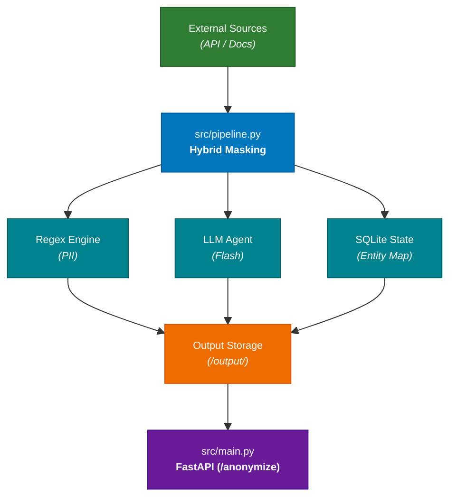

# System Design: Privacy-Preserving Data Anonymization Engine

## 1. Executive Summary

The objective of this architecture is to build a robust, high-performance data anonymization and privacy-preserving pipeline for **Kipu Pay**'s support corpus (2,028 chat messages, 26 documents, 6,243 table rows across CSVs and XMLs), fully satisfying the evaluation rubric and passing the strict official validator (`validar.mjs`).

The system must satisfy the official evaluation rubric:

- **Privacy / Leakage Prevention (45%):** Absolute eradication of PII (Real names, spelled-out emails, phone numbers, passport numbers, physical addresses, custom compound identifiers like *neighborhood + occupation + year*). Zero tolerance for blind hashing or unmasked leaks.
- **Utility (35%):** Retention of semantic value, correct document metadata structures (without deleting keys), correct table columns, preserved brand names / public figures, and format-valid synthetic values (cédulas, emails) to ensure the corpus remains trainable.
- **Consistency (20%):** Strict one-to-one deterministic mapping across all sources via persistent state (`data/entity_map.db`). The same individual receives the exact same synthetic pseudonym globally; identical real names receive distinct pseudonyms based on unique structural records.

## 2. System Architecture

The system follows a modular clean-architecture pattern (`notebooks/` for data science exploration, `src/` for core processing and API delivery, and `data/` for local state persistence). 

The pipeline produces the mandatory four output files in `output/`:

1. **`chats.jsonl`**: One message per line (`id` as `client_msg_id`, `thread_id`, `author` name, `ts`, `text`, `attachments`).
2. **`docs.jsonl`**: One document per line (`id`, `format`, `filename`, `title`, `body` with markdown/frontmatter/HTML comments, `metadata` object preserving all original keys).
3. **`tables.jsonl`**: One row per line (`id` as `<tabla>:<llave>`, `table`, `columns` object with all original column keys).
4. **`entities.json`**: The complete audit dictionary (`{"entities": [...]}`) tracking original forms, pseudonyms, records, and preserved public entities (`kept: true`).

## 3. Core Modules

### `src/config.py`

- **Responsibility:** Manages environment variables (`OPENROUTER_API_KEY`), configures OpenRouter client endpoints, and defines project path defaults.

### `src/pipeline.py`

- **Responsibility:** The core transformation and extraction engine.
  1. **Ingestion & Parsing:** Pulls data from the source API (`/v1`) using token authorization, handling Latin-1/UTF-8 charsets and custom separators.
  2. **Deterministic Regex Sweeper:** Instantly catches structured PII (emails, spelled-out email variants like *"user AT domain"*, passport numbers, vehicle plates, cédula ID formats).
  3. **Contextual LLM Extraction:** Feeds complex or ambiguous text fragments (Slack messages, PDF metadata, HTML comments) to an efficient LLM (`google/gemini-2.0-flash-001`) via OpenRouter with strict prompt instructions to flag compound identifiers and generalize quasi-identifiers (e.g., neighborhood + occupation + year).
  4. **Stateful Entity Resolution:** Queries and updates `data/entity_map.db` to guarantee consistent pseudonym assignment across historical runs and incremental source updates.

### `src/main.py`

- **Responsibility:** FastAPI web application exposing the complete participant API contract (`api/participante.openapi.yaml`):
  * `GET /health`: Returns service health status, team name, version, and active models.
  * `POST /run`: Triggers asynchronous full corpus regeneration from the source API into `output/` (SLA $< 2$ hours).
  * `GET /run/{job_id}`: Reports execution status (`queued`, `running`, `done`, `failed`), record counts, and token/time costs.
  * `GET /output/{archivo}`: Serves generated jsonl/json files (`chats.jsonl`, `docs.jsonl`, `tables.jsonl`, `entities.json`).
  * `POST /anonymize`: Processes incoming live batches of up to 50 records in $< 60$ seconds, guaranteeing consistent entity mapping against the local SQLite database.
  * `GET /entities`: Exposes the full entity dictionary for auditing by the automated judge.

## 4. Entity Resolution & Consistency Strategy

To ensure strict compliance with the 20% consistency score and correct homonym handling:

1. **Mapping Storage:** A local SQLite database (`data/entity_map.db`) stores cryptographic mappings:
   `[unique_entity_fingerprint] -> [synthetic_profile]`
   
2. **Deterministic Rules:**
   * **Homonym Separation:** Two distinct individuals sharing the name "Juan Pérez" generate unique entity fingerprints based on their underlying database IDs or contextual anchors, resulting in separate, unique synthetic profiles.
   * **Global Consistency:** When sources grow or `/anonymize` receives new records in real time, existing entities instantly resolve to their previously assigned pseudonyms.
   * **Preservation of Public Entities:** Organizations, places, brands, and public figures (e.g., Bancolombia, Carulla, Plaza Botero, Shakira) are explicitly marked as `kept: true` in `entities.json`.

## 5. API Contracts & SLA Targets

- **Full Regeneration (`POST /run`):** Re-renders the complete dataset into `output/` in $< 2$ hours, maintaining exact schema keys and row counts matching `record_index.json`.
- **Live Anonymization (`POST /anonymize`):**
  * **Input Payload:** JSON object containing `source` and an array of up to 50 raw records.
  * **Output Payload:** Strictly sanitized, pseudonymized records with identical schema IDs and corresponding entity metadata.
  * **Latency Target:** Response time $< 60$ seconds per batch.